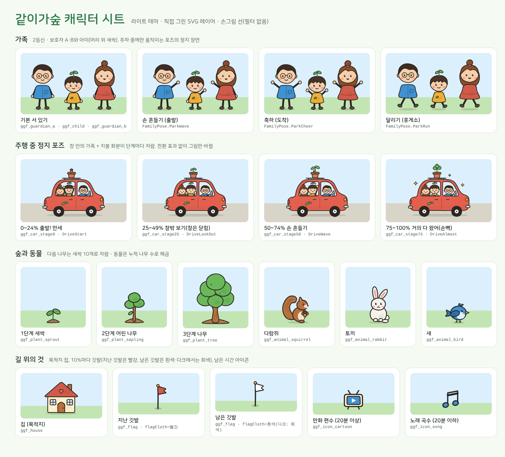
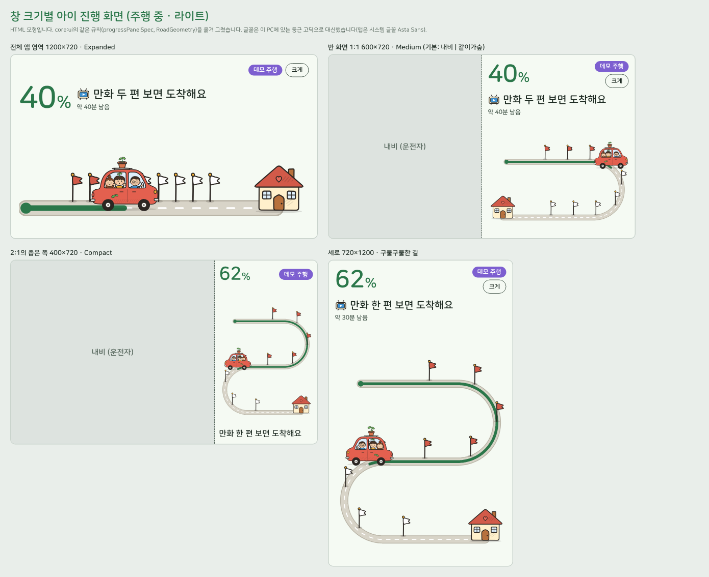

# 같이가숲 캐릭터와 아이 화면 그림

이 폴더에는 앱에 들어가는 그림의 원본과 시안이 있습니다. 그림은 모두 팀이 직접 그렸습니다. 생성형 AI 이미지와 외부 에셋은 쓰지 않았습니다.

## 캐릭터 시트



다크 테마: [character-sheet-dark.png](character-sheet-dark.png)

- **가족:** 보호자 A(동그란 안경), 보호자 B(정수리 똥머리), 아이(머리 위 새싹). 머리와 몸이 거의 같은 길이인 2등신입니다.
- **가족 차:** 창 안에 가족이 보입니다. 창은 늘 닫혀 있고, 유리 반사 선으로 닫힌 창을 표시합니다. 지붕 화분은 진행 단계마다 자랍니다(도토리 → 새싹 → 큰 새싹 → 어린 나무).
- **숲:** 새싹 → 어린 나무 → 나무 3단계, 동물 3종(도토리를 든 다람쥐, 한쪽 귀가 접힌 토끼, 정수리 깃털 두 가닥의 새).
- **길 위의 것:** 목적지 집, 10%마다 서는 깃발(지난 깃발 빨강, 남은 깃발 흰색), 남은 시간 아이콘(만화 편수, 노래 곡수).

## 주행 중 정지 포즈 4장

주행 중에는 그림이 움직이지 않습니다. 진행률이 25/50/75%를 넘을 때 그림만 바로 바뀝니다(전환 효과 없음).

| 진행률 | 포즈 | drawable | `FamilyPose` |
| --- | --- | --- | --- |
| 0~24% | 출발! 두 팔 만세, 지붕에 도토리 | `ggf_car_stage0` | `DriveStart` |
| 25~49% | 닫힌 창에 손을 대고 바깥 보기, 새싹 | `ggf_car_stage25` | `DriveLookOut` |
| 50~74% | 손 흔들기, 큰 새싹 | `ggf_car_stage50` | `DriveWave` |
| 75~100% | 눈웃음 손뼉, 어린 나무와 반짝이 | `ggf_car_stage75` | `DriveAlmost` |

작은 화면에서도 차이가 보이도록 지붕 화분의 모양(실루엣)이 단계마다 확실히 달라집니다.

## 창 크기별 아이 진행 화면

같이가숲은 보통 "내비(운전자) | 같이가숲(아이)" 반 화면에서 씁니다. 그래서 반 화면을 기본으로 설계하고, 좁은 창과 전체 앱 영역에서도 잘리거나 겹치지 않게 했습니다.



다크 테마: [layout-sizes-dark.png](layout-sizes-dark.png). 이 그림은 앱과 같은 규칙으로 그린 HTML 모형입니다. 실제 앱 화면은 Android Studio의 `core/ui` 미리보기(`Previews.kt`)에서 봅니다.

| 창 너비 (컴포넌트가 받은 자리) | 보이는 것 | 숨기는 것 |
| --- | --- | --- |
| 좁은 창, 600dp 미만 (2:1의 좁은 쪽) | 큰 %, 길과 차, 한 줄 문구(길 아래), 데모 배지 | 문구 옆 그림, 보조 줄("약 40분 남음"), 크게/작게 버튼 |
| 반 화면, 600~839dp (1:1) | 위 전부 + 문구 옆 그림, 보조 줄, 크게/작게 버튼 | 없음 |
| 전체 앱 영역, 840dp 이상 | 전부. 큰 %와 문구를 한 줄에, 배지·버튼은 맨 위 띠 | 없음 |
| 낮은 창, 높이 480dp 미만 (어느 너비든) | 큰 %와 문구를 한 줄에 놓고 글자를 줄임 | 보조 줄 |

- **길 모양:** 길 자리의 세로가 가로의 0.75배 이상이면 길이 S자로 구불구불하게 내려옵니다(반 화면, 좁은 창, 세로 화면). 넓고 낮은 자리에서는 곧은 길입니다. 왼쪽으로 가는 줄에서는 차를 좌우로 뒤집습니다.
- **글자 크기:** 큰 %는 120sp(전체)·96sp(반 화면)·72sp(좁은 창)에서 시작해 자리에 맞게 줄고, 48sp 아래로는 내려가지 않습니다. 아이 문장은 44·40·32sp에서 시작해 24sp까지 줄입니다. 주행 중에는 한 줄만 씁니다.
- **크기 판단:** 화면 전체가 아니라 컴포넌트가 실제로 받은 자리로 판단합니다. Pleos 화면의 실제 dp 값(2560×1440 px, 밀도 미확인)을 몰라도 어떤 분할에서든 같은 규칙이 맞습니다.

## 어떤 그림이 어디에 쓰이나

| drawable | 쓰는 컴포넌트 | 화면 |
| --- | --- | --- |
| `ggf_car_stage0/25/50/75` | `FamilyCharacter`(주행 포즈), `ProgressRoad` | 진행 화면(주행·정차) |
| `ggf_guardian_a`, `ggf_guardian_b`, `ggf_child` | `FamilyCharacter`(주차 포즈: 달리기·손 흔들기·축하) | 출발, 정차(휴게소), 도착, 첫 실행(아이만) |
| `ggf_house`, `ggf_flag` | `ProgressRoad` | 진행 화면 |
| `ggf_plant_sprout/sapling/tree` | `ForestScene` | 숲 결과, 홈의 숲 미리보기 |
| `ggf_animal_squirrel/rabbit/bird` | `ForestScene` | 숲 결과(해금된 동물만) |
| `ggf_icon_cartoon`, `ggf_icon_song` | `KidSentence(icon = …)` | 진행 화면 문구 옆 |

## 컴포넌트 (core:ui, 패키지 `app.familyjourney.core.ui`)

모두 상태를 받아 그리기만 합니다. 계산(진행률, 남은 시간 문장, 해금 규칙)은 기능 모듈이 합니다.

| 컴포넌트 | 하는 일 | 주행 중(`animate = false`) |
| --- | --- | --- |
| `KidProgressPanel(percent, sentence, driving, demo, …)` | 위 표대로 창 크기에 맞춰 배치 | 정지 그림, 문구 한 줄 |
| `ProgressRoad(percent, animate, milestonesEvery = 10)` | 길, 10%마다 깃발, 차 | 차가 1% 단위로 즉시 이동, 움직임 없음 |
| `FamilyCharacter(pose, animate)` | 주행 포즈 4장, 주차 포즈 3개 | 그림 그대로 |
| `ForestScene(trees, sprouts, animals, animate)` | 숲, 다음 나무 자라는 자리, 새싹 10칸 점 | 그림 그대로 |
| `BigNumberLabel(value)` | "40%" 큰 숫자(숫자 폭 고정) | 같음 |
| `KidSentence(text, driving, icon)` | 아이 문장 | 한 줄만 |
| `DemoBadge()` | "데모 주행" 배지 | 같음(늘 보임) |

주차 중 움직임은 짧게 정해진 횟수만 하고 멈춥니다(최대 약 2.7초). 앱이 백그라운드로 가면 멈춰 기다리고, 화면에서 빠지면 취소됩니다.

## 색

- 테마 색은 `core/ui/.../Tokens.kt`에 숫자로 있고, 글자 4.5:1·그림 3:1 대비를 단위 테스트(`ContrastTest`)가 라이트·다크 모두 검사합니다.
- 그림 안의 path 이름은 **색 역할**입니다(예: `skin`, `hairKid`, `shirtA`, `carBody`). 앱은 이 이름으로 라이트/다크 색을 바꾸고, 꾸미기(`FamilyLook`)에서는 머리색·옷색·차 색만 바꿔 칠합니다. 머리 모양 바꾸기는 레이어를 더해 PT 단계에서 합니다.
- 캐릭터의 바깥선과 눈은 두 테마 모두 어둡게 둡니다(밤에도 같은 얼굴). 서 있는 캐릭터의 팔다리와 깃대는 다크에서 밝게 바꿔 어두운 배경에 묻히지 않게 했습니다. 다크 테마의 집 창문에는 불이 켜집니다.
- `ForestGreen`(#2EB868)은 화면용 밝은 초록 제안값입니다. **실제 도착 축하 무드등에는 core:vehicle의 `MoodLightColors.FOREST_GREEN`(#2B774A) 하나만 씁니다**(결정 #23-⑤, 에뮬레이터에서 확인된 값). 실차에서 LED가 흐리게 보이면 그때 밝은 값으로 바꿉니다.

## 손그림 느낌을 내는 방법

VectorDrawable은 SVG 필터(크레파스 번짐)를 쓸 수 없습니다. 그래서 필터 대신 다음으로 냅니다.

- 동그라미와 몸통을 완전한 도형이 아니라 조금씩 흔들린 곡선으로 그립니다.
- 바깥선 일부를 한 번 더 그은 듯한 얇은 선(덧칠)을 둡니다.
- 면 안에 옅은 빗금(크레파스 결)을 넣습니다.

흔들림은 고정 시드라서 다시 만들어도 같은 그림이 나옵니다.

## 다시 만들기

그림을 고칠 때는 XML을 직접 고치지 않고 생성기를 고칩니다. 저장소 루트에서 실행합니다.

```bash
node design/characters/tools/build-assets.mjs
```

SVG 원본(`svg/`), 앱 VectorDrawable(`core/ui/src/main/res/drawable/ggf_*.xml`), 역할 색 표(`ArtRoleTokens.kt`)가 함께 바뀝니다.

```bash
node design/characters/tools/render-sheet.mjs
```

```bash
node design/characters/tools/render-layouts.mjs
```

시트와 창 크기 모형 PNG를 다시 찍습니다. Playwright(Chromium)가 필요합니다. 다른 곳에 설치돼 있으면 `PLAYWRIGHT_MODULE` 환경 변수로 경로를 알려 줍니다.

```bash
./gradlew :core:ui:testDebugUnitTest
```

생성된 그림이 색 역할 규칙과 맞는지(`DrawableRolesTest`)와 대비·배치 계산을 검사합니다.

## 오리지널 확인

- 가족 차에는 얼굴(눈·입)이 없습니다. 얼굴 달린 탈것 캐릭터와 겹치지 않게 하려는 것입니다.
- 사람은 둥근 얼굴, 점 눈, 볼 터치의 흔한 그림책 문법만 쓰고, 고유 표시는 우리 것으로 정했습니다(아이 머리 위 새싹, 지붕 화분, 문짝의 잎 무늬, 도토리를 든 다람쥐 = 팀 이름 도토리).
- 참고 이미지를 따라 그리지 않았습니다. 시작점은 우리 개요 페이지(`design/overview/index.html`)의 인라인 SVG입니다.

## 아직 확인하지 못한 것

- Compose 미리보기와 에뮬레이터 화면은 클라우드에서 볼 수 없어 아직 눈으로 확인하지 못했습니다. Android Studio에서 `core/ui`의 `Previews.kt`를 열어 크기별·라이트/다크 미리보기를 봅니다.
- Pleos 화면의 실제 dp 값. 확인되면 `Previews.kt` 맨 위의 미리보기 크기만 고칩니다.
