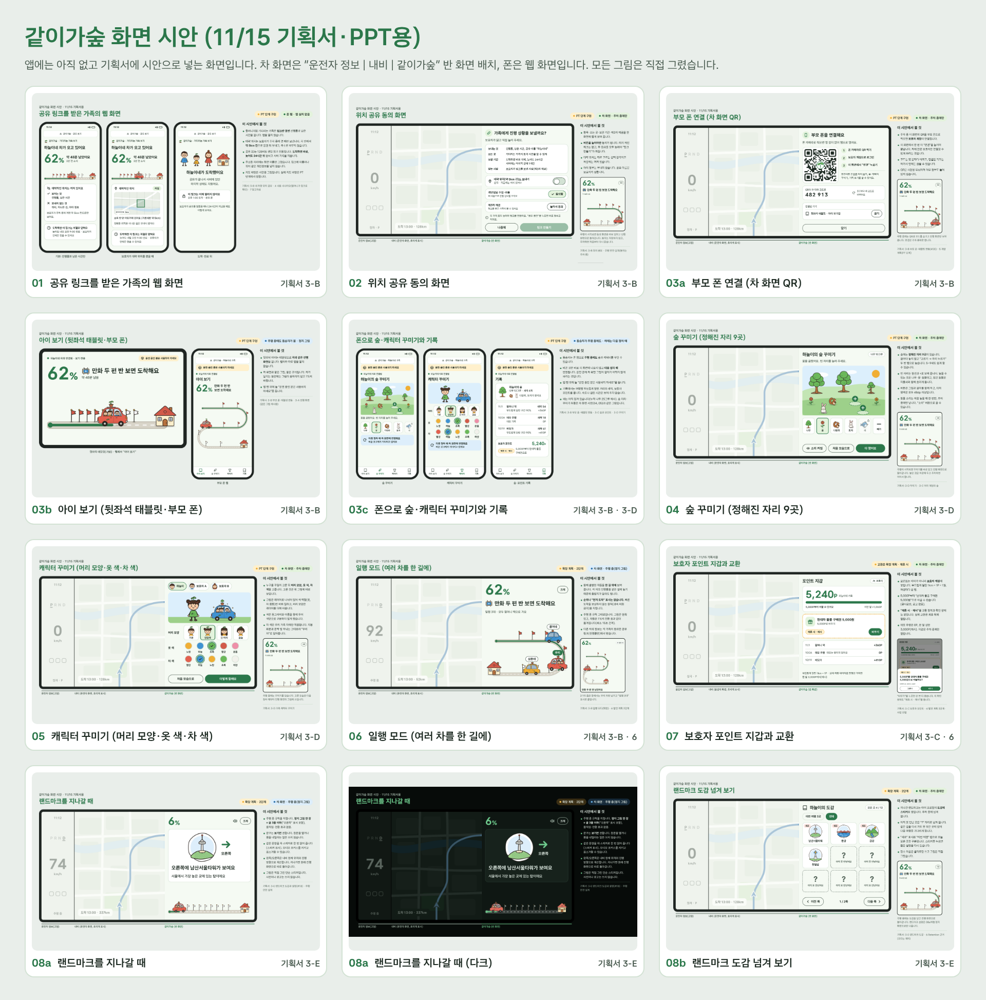

# 같이가숲 화면 시안 (11/15 기획서·PPT용)

11/15에는 앱에 넣지 않고 기획서에 **화면 시안**으로만 보여 주는 기능의 그림입니다(decisions.md #2, #8, #18~#20, #7-2, #7-3). 기획서(DOCX)와 PPT에는 `png/` 폴더의 PNG를 넣습니다.



- 캐릭터·색은 `design/characters/`의 SVG와 토큰(`core/ui` Tokens.kt와 같은 값)을 그대로 씁니다. 진행 길은 앱의 `RoadGeometry.kt`와 같은 계산으로 그렸습니다.
- 차 화면은 **"운전자 정보(고정) | 내비 | 같이가숲" 반 화면 배치**(#19)입니다. 운전자 정보와 내비는 우리 화면이 아니라서 흐리게 그렸습니다.
- 폰 시안은 앱 설치 없이 여는 **웹 화면**입니다. 주소창 자리에는 주소 대신 화면 이름만 그렸습니다.
- 예시 이름은 가상의 별명(하늘이, 콩이네, 삼촌네)입니다. 회사 로고와 실제 사진은 쓰지 않았고, "현대차 물품 구매권"은 글자로만 씁니다.

## 시안 목록

| PNG | 화면 | 상태 | 기획서 항목 | 보면 좋은 곳 |
| --- | --- | --- | --- | --- |
| `png/00-contact-sheet.png` | 모아 보기 | | 7 참고자료 | 한 장에 전체 시안 |
| `png/01-share-web.png` | 공유 링크를 받은 가족의 웹 화면 | 폰 웹 | 3-B 위치 공유, 4 시나리오 | "하늘이네 차가 오고 있어요 62%, 약 48분 남았어요", 대략 위치 꺼짐(기본)·켜짐(약 5km 칸)·도착 후 만료 |
| `png/02-share-consent.png` | 위치 공유 동의 | 차 · 주차 중 | 3-B, 주행 안전 설계 | 항목·쓰는 곳·보관 기간·제3자 제공, 버튼을 눌러야 동의(미리 켜진 체크 없음), 주행 중이 되면 닫힘 |
| `png/03a-link-qr.png` | 부모 폰 연결(QR) | 차 · 주차 중 | 3-B 폰·태블릿 연동(#20) | QR + 바뀌는 코드, 차 화면에서 한 번 더 "연결", 연결된 기기 끊기 |
| `png/03b-link-kid-view.png` | 아이 보기 | 뒷좌석 태블릿·부모 폰 웹 | 3-B | 차와 같은 진행 화면(정지 그림), "운전 중인 분은 사용하지 마세요" |
| `png/03c-link-phone-decorate.png` | 폰으로 숲·캐릭터 꾸미기와 기록 | 부모 폰 웹 | 3-B, 3-C, 3-D | "다음 정차 때 차 화면에 반영돼요", 운전자 경고, 여행별 새싹·포인트 기록 |
| `png/04-forest-decorate.png` | 숲 꾸미기(정해진 자리 9곳) | 차 · 주차 중 | 3-D, 3-C | 고르기 → 빈 자리 누르기(두 번 탭), 잠긴 동물, 소리 끄기 |
| `png/05-character-decorate.png` | 캐릭터 꾸미기 | 차 · 주차 중 | 3-D | 머리 모양 4가지(레이어), 옷 색·차 색(역할 색 바꾸기), 색 이름 함께 표시 |
| `png/06-group-mode.png` | 일행 모드 | 차 · 주행 중 | 3-B 확장, 6 발전 계획 2단계 | 여러 차를 한 길에, 순위·"먼저 도착" 없음, 좁은 창에서는 우리 차만 |
| `png/07-points-exchange.png` | 보호자 포인트 지갑과 교환 | 차 · 주차 중 | 3-C, 6 사업 모델 | 5,240P, "현대차 물품 구매권 5,000원 = 5,000P", **"제휴 시 · 예시"** 표기, 확인 창 |
| `png/08a-landmark-pass.png` | 랜드마크를 지나갈 때 | 차 · 주행 중 | 3-E(#18) | 정지 그림 + 글 3줄 이하, "오른쪽에 남산서울타워가 보여요"(보기만 권함) |
| `png/08a-landmark-pass-dark.png` | 같은 화면, 다크 | 차 · 주행 중(밤) | 3-E | 다크 테마 |
| `png/08b-landmark-book.png` | 랜드마크 도감 | 차 · 주차 중 | 3-E, 6 Retention | 모은 스티커, "?" 자리, 이번 여행 표시, 쪽 넘기기 |

PNG는 가로 2880px(1.5배)입니다. DOCX에는 본문 폭에 맞춰, PPT에는 슬라이드 폭에 맞춰 넣으면 됩니다.

## 주행 중 / 주차 중 차이

- **주행 중 화면(06, 08a):** 그림이 움직이지 않습니다. 진행률은 1%씩 전환 효과 없이 바뀌고(최소 15초 간격), 글은 짧게(08a는 3줄 이하), 터치는 "크게"만 둡니다.
- **주차 전용 화면(02, 03a, 04, 05, 07, 08b):** 02, 03a, 04, 05, 08b의 오른쪽 설명 칸 작은 화면이 "주행이 시작되면" 돌아가는 모습입니다. 모두 같은 규칙으로 진행 화면으로 바로 돌아가고, 주행 중 화면에는 문구를 더 늘리지 않습니다. 07의 작은 화면은 교환 확인 창이고, 지갑도 주행이 시작되면 같은 방식으로 닫힙니다.
- **폰·태블릿 웹(01, 03b, 03c):** 차 화면이 아니라 동승자·기다리는 가족이 씁니다. 그래도 진행 화면은 차와 같은 정지 그림을 쓰고, 웹 맨 위에 "운전 중인 분은 사용하지 마세요"를 둡니다. 폰에서 바꾼 꾸미기는 다음 정차 때 차에 반영됩니다.

## 접근성 점검 (2026-11-02)

`render-mockups.mjs`가 PNG를 찍을 때마다 화면 틀 안의 글자를 모두 재서 알려 줍니다.

- 글자 대비: 모든 글자가 실제 바탕색 대비 **4.5:1 이상**(라이트 최저 5.17:1 = 큰 % 숫자 숲 초록, 다크 최저 9.21:1). 꺼진 버튼("링크 만들기" 동의 전)과 잠긴 항목은 WCAG 예외라 따로 셉니다.
- 글자 크기: 차 화면 최소 15px(dp), 폰 웹 최소 14px. 모두 12sp 이상입니다.
- 터치 영역: 차 화면 버튼·타일 48dp 이상, 폰 44px 이상(색 고르기는 동그라미와 이름 전체가 누르는 자리).
- 색만으로 구분하지 않기: 색 견본에는 이름과 체크 표시, 상태 표시는 글자("켜짐", "제휴 시 · 예시", "새로")를 함께 둡니다.
- 운전자 정보·내비 영역은 우리 화면이 아니라서 흐리게 그렸고, 점검에서 뺍니다.

## 다시 만들기

저장소 루트에서 실행합니다. Node 22와 Playwright(Chromium)가 필요합니다. 다른 곳에 설치돼 있으면 `PLAYWRIGHT_MODULE` 환경 변수로 경로를 알려 줍니다.

```bash
node design/mockups/tools/render-mockups.mjs
```

- 결과: `svg/`(새로 그린 그림 원본), `html/`(시안 HTML과 `assets/` 캐릭터 SVG), `png/`(PNG와 모아 보기).
- 한두 장만 다시 찍기: `MOCKUP_ONLY=02-share-consent,00-contact-sheet node design/mockups/tools/render-mockups.mjs`
- 배율 바꾸기: `MOCKUP_SCALE=2 node design/mockups/tools/render-mockups.mjs`
- 글꼴: 처음 실행할 때 Google Fonts에서 Asta Sans(SIL OFL 1.1)를 `design/mockups/.font-cache/`에 받아 PNG에만 씁니다. 이 폴더는 git에 넣지 않습니다. 받지 못하면 설치된 둥근 고딕으로 대신 그리고 경고를 띄웁니다.
- `html/*.html`은 브라우저로 바로 열어 볼 수 있습니다(글꼴 캐시가 없으면 다른 글꼴로 보임).
- 시안을 고칠 때는 HTML을 직접 고치지 않고 `tools/render-mockups.mjs`(화면)와 `tools/lib.mjs`(색·틀·길·새 그림)를 고칩니다. 캐릭터 그림 자체는 `design/characters/tools/build-assets.mjs`에서 고칩니다.

## 새로 그린 그림 (`svg/`)

| 파일 | 내용 | 쓰는 시안 |
| --- | --- | --- |
| `flower_red.svg`, `flower_yellow.svg` | 숲 꾸미기용 꽃 2가지 | 03c, 04 |
| `landmark_namsan_tower.svg`, `landmark_han_river.svg`, `landmark_geum_river.svg`, `landmark_hanbit_tower.svg` | 랜드마크 스티커 4장(단순한 손그림, 사진·로고 아님) | 08a, 08b |
| `hair_kid_pigtails_front.svg`, `hair_kid_long_back.svg`, `hair_kid_curly_back.svg` | 아이 머리 모양 레이어(아이 그림 120×150 좌표, 앞/뒤 레이어) | 03c, 05 |
| `qr_pattern.svg` | QR처럼 보이는 무늬. **아무 정보도 들어 있지 않은** 시안용 그림 | 03a |

머리 모양 레이어는 꾸미기 기능을 앱에 넣을 때(PT 단계) `build-assets.mjs`의 아이 그림 레이어로 옮기면 됩니다.

## 아직 정하지 않은 것

- 공유 웹의 지도 바탕: 시안은 직접 그린 단순한 지도입니다. 실제 지도 바탕(타일 서비스와 라이선스)은 PT 단계에서 정합니다. 주소 변환(외부 지오코딩)은 쓰지 않습니다.
- 공유 이름: 시안은 "하늘이네"입니다. 아이 별명이 들어가므로 보호자가 직접 정하게 하고, 기본값은 "우리 가족 차"처럼 이름 없는 말로 두는 것을 제안합니다.
