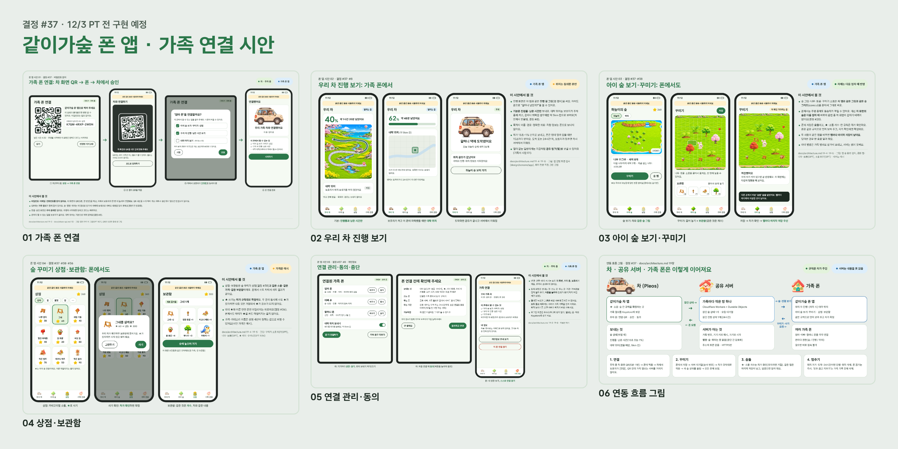

# 같이가숲 폰 앱 · 가족 연결 시안 (결정 #37)

11/15 기획서·PPT용 **폰 앱 화면 시안과 연동 흐름 그림**이다. 폰 앱은 12/3 PT 전까지 구현하고, 11/15에는 이 시안만 쓴다. 설계는 `docs/architecture.md` 19장, API는 `docs/share-api.md`.



| PNG | 내용 | 기획서 항목 |
| --- | --- | --- |
| `png/00-contact-sheet.png` | 모아 보기 | 7 참고자료 |
| `png/01-phone-pair.png` | 가족 폰 연결: 차(주차 중) QR → 폰이 찍음 → 차에서 보호자 승인(권한 고르기) → 연결됨. 비밀번호 없음 | 3 주요 기능, 4 시나리오 |
| `png/02-phone-trip.png` | 우리 차 진행 보기: 기본은 진행률·남은 시간만, 허락한 폰만 대략 위치(5km 칸), 도착하면 공유 끝·서버 삭제 | 3-B 위치 공유 |
| `png/03-phone-forest.png` | 아이 숲 보기·꾸미기: 차와 같은 숲 그림, 끌어 놓기·보관함, 차 확인 후 확정, 맵마다 마지막 저장 우선 | 3-C·3-D |
| `png/04-phone-shop.png` | 꾸미기 상점·보관함: ★로 사기(차가 확정), 같은 보관함. **가격은 예시** | 3-C, 6 Retention |
| `png/05-phone-manage.png` | 연결 관리·동의·중단: 차에서 기기별 권한·끊기·위치 켜기, 동의 화면, 폰에서 스스로 끊기 | 개인정보·주행 안전 설계 |
| `png/06-sync-flow.png` | 연동 흐름 그림: 차(규칙 주인) · 공유 서버(내용을 못 읽음) · 가족 폰 | 5 개발 계획 |

- 모든 폰 화면 맨 위에 "운전 중인 분은 사용하지 마세요"(#20).
- 그림: 앱 화면 캡처(`design/screens/app`의 숲·진행 길을 잘라 씀), GPT 그림(우리 차, 공원 맵, 나무·동물, 꾸미기 소품 R27, ★ 배지·주머니 R36, 버튼 아이콘 R39). 늘리지 않고 색 필터 없음. 위치 칸 지도와 QR은 직접 그린 모양(실제 QR 아님).
- 예시 이름(하늘이, 바다, 엄마 폰)은 가상이다. 소품 가격·카테고리는 숲 꾸미기 상점 세션의 값으로 바뀔 수 있다.

## 다시 만들기

```bash
# 글꼴(처음 한 번, git 제외): Asta Sans 400/600/700/800 → design/phone/.font-cache/AstaSans-<굵기>.ttf
for w in 400 600 700 800; do u=$(curl -sSfL "https://fonts.googleapis.com/css2?family=Asta+Sans:wght@$w" | grep -oE "https://[^)]+"); \
  curl -sSfL "$u" -o design/phone/.font-cache/AstaSans-$w.ttf; done
node design/phone/tools/render.mjs            # PNG 1.5배(가로 2880px 안팎)
MOCKUP_ONLY=03-phone-forest node design/phone/tools/render.mjs   # 하나만
```

HTML은 `html/`에 생기며 브라우저로 바로 열 수 있다. 그림 조각은 `html/assets/`.
